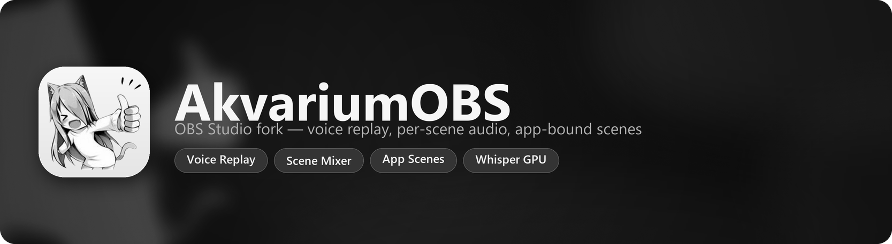

<p align="center">
  
</p>

<p align="center">
  <a href="COPYING"></a>
  
  
  
  
</p>

<p align="center">
  <a href="#english"><b>English</b></a> &nbsp;&bull;&nbsp; <a href="#russian"><b>Русский</b></a>
</p>

---

<a id="english"></a>
## English

[Переключиться на русский](#russian)

### Overview

AkvariumOBS is a dedicated fork of **OBS Studio 32.2.2** (GPLv2) enhanced with key stream and gameplay recording features absent from upstream OBS:

| | Feature | Purpose |
|---|---|---|
| 🎙 | **Voice Commands for Replay Buffer** | Save instant replays hands-free by speaking phrases like "save replay" or "clip that" — 100% offline |
| 🔊 | **Replay Clip Sound** | Plays a configurable audio chime whenever a replay buffer is saved (via voice, hotkey, or button) |
| 🎚 | **Per-Scene Audio Mixer State** | Automatically remembers and restores source volume and mute states per scene |
| 🪟 | **Scene Binding to Applications** | Automatically changes scenes when a targeted application focuses, minimizes, or exits |

Product naming, window title, `AkvariumOBS.exe`, Windows version metadata, icons, and custom UI components are fully rebranded. Internal OBS identifiers, configuration directories, and plugin ABI remain unchanged, preserving 100% compatibility with existing OBS Studio plugins and profiles.

---

### Features

#### 🎙 Voice Commands for Replay Buffer

**Settings → Output → Replay Buffer → Voice Commands (Replay Buffer)**

- **Smart Speech Architecture:** Powered by `whisper.cpp` with bundled 8-bit quantized `base-q8_0` model. Uses ~75 MB RAM with ~80 ms inference latency. No network connection needed.
- **5-Sample Repetition Enrollment:** Click **"Train new phrase (5 samples)"**, say your trigger phrase 5 times. The engine captures acoustic variants and builds custom vocabulary aliases automatically.
- **Pill Tag Phrase Management:** Enrolled phrases appear as visual pill badges with one-click deletion (`[ ✕ phrase ]`).
- **Initial Prompt Keyword Biasing:** Whisper is prompted dynamically with your active phrase aliases, ensuring high recognition accuracy even through heavy gaming accents or background noise.
- **False Trigger Rejection:** VAD silence trimming and speech duration limits reject background chatter, Discord voice chat, and game sound effects.
- **Test Recognition Tool:** Built-in microphone verification button displays real-time transcription and confidence scoring.

#### 🔊 Replay Clip Sound

**Settings → Output → Replay Buffer → Replay Sound (Replay Buffer)**

- Drop `.wav`, `.mp3`, or `.wma` audio files into `%APPDATA%\obs-studio\AkvariumOBS\sounds` (or `config\AkvariumOBS\sounds` in portable mode).
- Plays on the default Windows audio output device whenever a replay is saved (via voice command, hotkey, or UI button), allowing stream desktop capture to include the feedback sound.
- Independent volume slider and test playback button.

#### 🎚 Per-Scene Audio Mixer State

- Automatically persists mute and volume state for all sources in the Audio Mixer (including global devices like `Mic/Aux` and `Desktop Audio`) on scene transitions.
- Right-click any scene:
  - **Remember volume and mute for this scene** — toggle tracking for this scene.
  - **Capture current audio state for this scene** — take an immediate snapshot.

#### 🪟 Scene Binding to Applications

Dock panel **Scene Binding to Applications** (right sidebar):
- Configurable rules based on executable name, state (`In foreground`, `Running`, `Running but not in foreground`, `Not running / closed`), and target scene.
- Checked every 700 ms; switches scenes seamlessly without interrupting recordings or streams.

---

### Installation & Downloads

Official release packages:

```text
AkvariumOBS-1.1b-Windows-x64-Installer.exe   Windows NSIS Installer (solid LZMA)
AkvariumOBS-1.1b-Windows-x64-Portable.zip    Portable standalone archive
```

- **Installer:** Installs to `Program Files\AkvariumOBS`, registers shortcuts, uninstaller in Windows Settings. Silent mode: `installer.exe /S /D=D:\path`.
- **Portable:** Unpack anywhere, run `bin\64bit\AkvariumOBS.exe`. Add `--portable` to store settings locally in `.\config`.
- Bundles the recognition model (`data\voice\ggml-base-q8_0.bin`), VC++ CRT, OpenMP, and Vulkan loader. Zero extra runtimes required.

---

### Quick Start

1. Open **Settings → Output**, enable **Replay Buffer**, scroll to **Voice Commands**.
2. Check **Enable voice commands for Replay Buffer**.
3. Click **"Train new phrase (5 samples)"**, enter e.g. `clip that` or `save replay`, and speak the phrase 5 times when prompted.
4. Leave microphone on **Auto** (follows active scene mic).
5. Start the Replay Buffer and speak your phrase!

---

### Building from Source

Requirements:
- Visual Studio 2022 Build Tools (**Desktop development with C++** and **C++ ATL**)
- Windows 11 SDK 10.0.26100
- CMake 3.28+ (Visual Studio 17 2022 generator)

```bash
cmake -S . -B build_x64 -G "Visual Studio 17 2022" -A x64 -DENABLE_BROWSER=ON
cmake --build build_x64 --config RelWithDebInfo --parallel
```

Run test suite:
```bash
cmake --build build_x64 --config RelWithDebInfo --target akvarium-phrase-match-test
build_x64\rundir\RelWithDebInfo\bin\64bit\akvarium-phrase-match-test.exe
```

Build release packages:
```powershell
powershell -ExecutionPolicy Bypass -File packaging\build_release.ps1
```

---

<a id="russian"></a>
## Русский

[Switch to English](#english)

### Что это

AkvariumOBS — не плагин и не обёртка, а полноценный форк исходников OBS Studio 32.2.2.
Четыре возможности для стримов и записи геймплея, которых нет в обычном OBS:

| | Возможность | Зачем |
|---|---|---|
| 🎙 | **Голосовые команды для Replay Buffer** | Сказать «откати это» или «save replay» вместо хоткея — распознавание полностью офлайн |
| 🔊 | **Звуковое оповещение клипа** | Проигрывание выбранного звука при каждом сохранении реплея (по голосу, кнопке или хоткею) |
| 🎚 | **Состояние микшера на сцену** | Микрофон заглушён в одной сцене и активен в другой, автоматически при переключении |
| 🪟 | **Привязка сцен к приложениям** | Сцена меняется, когда игра в фокусе, свернулась или закрылась |

Продуктовое имя, заголовок окна, `AkvariumOBS.exe`, версионный ресурс Windows, иконки
(exe, окно, трей) и тексты своего UI перебрендированы. Внутренние идентификаторы OBS,
пути конфигов и ABI плагинов не тронуты — сторонние плагины и профили апстрима работают как раньше.

---

### Возможности

#### 🎙 Голосовые команды для Replay Buffer

**Настройки → Вывод → Replay Buffer → Voice Commands (Replay Buffer)**

- **Архитектура Medal:** Распознавание на базе `whisper.cpp` со встроенной моделью `base-q8_0`. Занимает всего ~75 МБ RAM, инференс ~80 мс. Работает полностью локально без интернета.
- **Мастер тренировки фразы (5 сэмплов):** Нажмите **"Train new phrase (5 samples)"**, произнесите фразу 5 раз с подсказками VAD. Система автоматически сохранит вариации произношения в словарь.
- **Удобные теги фраз:** Фразы отображаются кнопками-плашками с удалением в один клик (`[ ✕ фраза ]`).
- **Keyword Biasing:** Динамический `initial_prompt` с вашими фразами подсказывает Whisper приоритетные слова, предотвращая ошибки даже при шуме или неидеальной дикции.
- **Защита от ложных срабатываний:** VAD-обрезка тишины, лимит длительности и умная фильтрация отсекают разговоры в Discord, музыку и звуки игры.
- **Проверка микрофона:** Кнопка **"Test recognition"** показывает точность сопоставления в реальном времени.

#### 🔊 Звук сохранения реплея

**Настройки → Вывод → Replay Buffer → Replay Sound (Replay Buffer)**

- Поддерживаются `.wav`, `.mp3` и `.wma` файлы в папке `%APPDATA%\obs-studio\AkvariumOBS\sounds` (или `config\AkvariumOBS\sounds` в portable-режиме).
- Звук проигрывается на стандартное устройство вывода Windows при любом сохранении клипа (по голосу, горячей клавише или кнопке в OBS), попадая в захват звука рабочего стола на стриме.
- Отдельный ползунок громкости и кнопка прослушивания.

#### 🎚 Состояние микшера на сцену

- При переключении сцены состояние уходящей сцены сохраняется в её JSON, состояние входящей — применяется. Охвачены все источники из Audio Mixer, включая глобальные устройства (`Mic/Aux`, `Desktop Audio`).
- Правый клик по сцене:
  - **Remember volume and mute for this scene** — включить/выключить запоминание для сцены;
  - **Capture current audio state for this scene** — сохранить текущий снимок.

#### 🪟 Привязка сцен к приложениям

Док **Scene Binding to Applications** (справа):
- Правило — это exe, условие (`In foreground`, `Running`, `Running but not in foreground`, `Not running / closed`), целевая сцена и флаг «включено».
- Правила проверяются каждые 700 мс.

---

### Установка

Готовые релизные пакеты:

```text
AkvariumOBS-1.1b-Windows-x64-Installer.exe   установщик (NSIS, LZMA)
AkvariumOBS-1.1b-Windows-x64-Portable.zip    портативная сборка
```

- **Установщик:** Ставит в выбранную папку, прописывает `HKLM\Software\AkvariumOBS`, добавляет пункт в «Удаление программ» и ярлыки. Тихая установка: `installer.exe /S /D=D:\path`.
- **Portable:** Распакуйте в любую папку и запустите `bin\64bit\AkvariumOBS.exe`. Флаг `--portable` хранит настройки локально в `.\config`.
- В сборку уже вложены модель речи `ggml-base-q8_0.bin`, VC++ runtime, OpenMP и Vulkan loader.

---

### Быстрый старт

1. Настройки → Вывод → включить Replay Buffer, открыть **Voice Commands**.
2. Включить чекбокс **Enable voice commands for Replay Buffer**.
3. Нажать **"Train new phrase (5 samples)"**, ввести `откати это` или `save replay` и произнести фразу 5 раз.
4. Микрофон оставить на **Auto** (следует за микрофоном активной сцены).
5. Запустить Replay Buffer и произнести команду!

---

### Сборка из исходников

Требования:
- Visual Studio 2022 Build Tools (**Desktop development with C++** и **C++ ATL**)
- Windows 11 SDK 10.0.26100
- CMake 3.28+ (генератор Visual Studio 17 2022)

```bash
cmake -S . -B build_x64 -G "Visual Studio 17 2022" -A x64 -DENABLE_BROWSER=ON
cmake --build build_x64 --config RelWithDebInfo --parallel
```

Тесты сопоставления:
```bash
cmake --build build_x64 --config RelWithDebInfo --target akvarium-phrase-match-test
build_x64\rundir\RelWithDebInfo\bin\64bit\akvarium-phrase-match-test.exe
```

Сборка инсталлятора и portable:
```powershell
powershell -ExecutionPolicy Bypass -File packaging\build_release.ps1
```

---

## Лицензия

GPLv2, как и OBS Studio. Исходный код доступен в соответствии с требованиями лицензии.

Благодарности:
- [OBS Studio](https://obsproject.com) — основа форка;
- [whisper.cpp](https://github.com/ggml-org/whisper.cpp) — офлайн-распознавание речи;
- [Qt](https://www.qt.io) и [CEF](https://github.com/chromiumembedded/cef) — графический интерфейс и браузерные источники.
